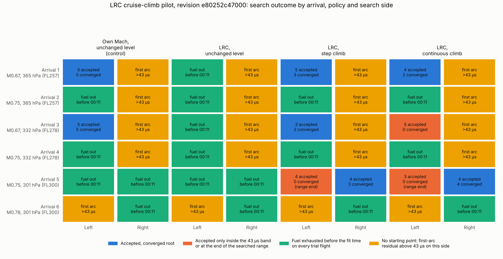

# LRC cruise-climb pilot, revision e80252c47000: results

Prepared 22 November 2026. The run used the frozen revision `e80252c47000` under `RELEASE_PILOT.json` (SHA-256 `c32a5865…4cc9`, release commit `e91b056`). The gate passed on 21 November with G6 advisory. All times below are UTC unless marked otherwise.

This report covers the scientific result requested in §6 of the pilot handoff. The report-only corrections dated 22 November 2026 were checked against the saved results; the run, CSV values, figure, frozen revision and G6 decision are unchanged. It makes no compatibility claim and no final timing or frequency prediction, and it contains no 22:41 calculation.

## 1. What was executed

| Session | Worker | Start – end (UTC) | Ending | Started at commit |
|---|---|---|---|---|
| 1 | w0 (arrivals 1, 3, 5) | 08:43:34 – 10:33:54 | PAUSED (6,600 s admission threshold) | `e91b056` |
| 1 | w1 (arrivals 2, 4, 6) | 08:43:36 – 10:25:09 | FINISHED | `e91b056` |
| 2 | w0 | 10:34:34 – 12:24:43 | PAUSED (6,600 s admission threshold) | `945c0df` |
| 3 | w0 | 12:25:15 – 12:33:34 | FINISHED | `8b4c738` |

- **Commands and interpreter.** Each session ran `/usr/local/bin/python3.13 -B -u lrc_pilot.py worker <w> 6600` (Python 3.13.18) from this directory.
- **Pause threshold.** The `6600` argument is an admission-pause threshold. A worker checks it before starting each new attempt and stops cleanly once the threshold has passed. It was needed because this environment allows a background process at most 2 h. It does not change the time allocations, and each resume continued with the same revision, release and time account.
- **Checkpoints.** After every session, `lrc_pilot.py status` succeeded and the records were committed and pushed: `945c0df`, `8b4c738` and `728ce09`.
- **Time charged.**
  - w0: 13,699.8 s of 43,200 s.
  - w1: 6,074.7 s of 43,200 s.
  - Gate: 658.0 s.
  - Total: 20,432.6 s against the 90,000 s ceiling.
- **Interruptions and stops.** No attempt was interrupted. No stop is unresolved. No control failed to reproduce its established result.
- **Configurations.** The run covered 24 configurations: 6 arrival states × 4 cruise policies. Each was searched on both sides of the first-turn search, giving 48 side outcomes.
- **Not run.** No other analysis was run. There was no 22:41 consistency stage, no terminal propagation, no impact calculation, and no satellite-compatibility evaluation at 00:19 (`satcom_evaluated` is false on every row).

**Files in this folder**

| File | Contents |
|---|---|
| `pilot_config_sides.csv` | One row per configuration and side (48 rows). |
| `pilot_accepted_flights.csv` | All 45 returned flight records: 10 controls, 32 retained LRC records and 3 superseded round-1 L3_STEP records. |
| `pilot_numerical_repeats.csv` | The 10 numerical repeat checks. |
| `pilot_states_0019.csv` | States or explicit unavailability at 00:19:29 and 00:19:37 for the 42 retained flight records (84 rows). |
| `pilot_outcome_grid.png` | The outcome matrix. |

All values in these files were copied from the committed records in `run/e80252c47000/w0` and `w1`. In the existing accepted-flight CSV, `final_round` applies to the LRC feedback rounds: it is also `False` for the ten OWN controls. Select the retained set using `policy == "OWN_MACH_UNCHANGED_LEVEL" or final_round == True`; `final_round == True` alone selects only the 32 retained LRC rows. The CSV is preserved as published.

Counts are returned flight records, not counts of independent routes or physical branches. Multiple solver starts can return the same route; L3_CC indices 0 and 1, for example, have identical turn parameters, residuals and continuation but different search labels.

## 2. Terms

- **Arrival.** The aircraft state imposed at 19:41:03: a Mach number and a pressure level. Pressure altitudes below use the standard atmosphere.

  | Arrival | Mach | Pressure level | Pressure altitude |
  |---|---|---|---|
  | 1 | 0.67 | 365.1 hPa | about 25,700 ft |
  | 2 | 0.75 | 365.1 hPa | about 25,700 ft |
  | 3 | 0.67 | 331.7 hPa | about 27,800 ft |
  | 4 | 0.75 | 331.7 hPa | about 27,800 ft |
  | 5 | 0.75 | 300.9 hPa | about 30,000 ft |
  | 6 | 0.78 | 300.9 hPa | about 30,000 ft |

- **Policies.** The four cruise policies are:
  - own Mach at an unchanged level (OWN), the historical control;
  - long-range-cruise Mach at an unchanged level (LRC);
  - LRC Mach with step climbs (STEP);
  - LRC Mach with a continuous cruise climb (CC).

  Under the LRC policies, the commanded Mach and level depend on the aircraft's own mass and atmosphere history. They are therefore found by iteration.
- **Route parameters.** Each route has a first turn (angle d1, in degrees), and may have a second turn. The second turn has a start time t2, in seconds on the model's flight clock from 19:41:03 (searched over 4,500–6,300 s), and an angle d2, in degrees. The search covers two sides: left (negative d1, searched over −20° to 0°) and right (positive d1).
- **Timing residual.** The measured burst timing offset minus the model's predicted one, in microseconds. It is fitted at the 20:41:05, 21:41:27 and 00:11:00 handshakes. A flight is **accepted** when the engine accepts the flight and all three residuals are within ±43 µs, which is the campaign's established tolerance. A record labelled **CONVERGED_ROOT** additionally meets the solver's 1 µs target for the 21:41 and 00:11 residuals after the first-turn anchor is fixed. Optional polishing may reduce them further; the label does not promise that all three residuals are below 0.1 µs.
- **Feedback (command) consistency.** For an LRC policy: whether the commands that the flight's own history implies match the commands that were flown.

## 3. Configuration and search outcomes

Of the 48 side outcomes:

| Outcome | Sides | Meaning |
|---|---|---|
| Accepted flight found | 10 | At least one accepted record: 7 sides have a converged root, 1 has in-band records without a converged root, and 2 have accepted records only at the first-turn range boundary. |
| Fuel exhausted before the fit time on every trial flight | 18 | Every trial flight reached fuel exhaustion before the 00:11 fitted handshake. |
| No starting point (timing mismatch) | 20 | No first-turn sample on this side came within 43 µs at 20:41. The smallest first-arc residual on these sides was 62–385 µs. |
| Limited by model support | 0 | No sample was excluded for buffet, thrust, Mach support, bank or crab limits. The only unsupported category recorded was the fuel event. |
| POLICY_UNDEFINED | 0 | |
| NO_USABLE_HISTORY | 0 | |

**Main pattern.**
- Accepted flights occur only for arrivals 1, 3 and 5. These are the slower arrival at each of the two lower levels (M0.67), and M0.75 at 300.9 hPa.
- Arrivals 2, 4 and 6 (M0.75 at the two lower levels, M0.78 at 300.9 hPa) have no accepted flight under any policy. On every side they either exhaust fuel before 00:11:00 or have no starting point.
- **LRC at an unchanged level has no accepted flight for any arrival.** For arrivals 1–4, the left side exhausts fuel before 00:11:00 and the right side has no starting point. Arrival 5 exhausts fuel on both sides. Arrival 6 has no starting point on the left and exhausts fuel on the right.
- The two climbing LRC policies (STEP and CC) have accepted flights for arrivals 1, 3 and 5. Under these climbing policies the flights still have fuel at 00:11:00. At an unchanged LRC level they do not. Lower fuel flow at the higher cruise levels is the likely physical reason, but this run did not isolate it.

| Configuration | Side | Accepted | Converged | First turn d1 (°) | Residual range (largest of the three, µs) | Note |
|---|---|---|---|---|---|---|
| L1_OWN | L | 5 | 5 | −5.37 | ≤ 0.1 | Control |
| L1_STEP | L | 5 | 3 | −4.21 | 0.01–16.3 | |
| L1_CC | L | 4 | 2 | −4.23 | 0.08–4.9 | |
| L3_OWN | L | 5 | 5 | −8.74 | ≤ 0.1 | Control |
| L3_STEP | L | 3 | 2 | −7.39 | 0.34–8.0 | Round 2 (see §4) |
| L3_CC | L | 5 | 0 | −7.40 | 9.6–16.4 | Inside the 43 µs band only; no converged root |
| L5_STEP | L | 4 | 0 | 0.00 | 28.7–40.5 | Only at the end of the searched range (d1 = 0) |
| L5_STEP | R | 4 | 3 | 0.56 | 0.01–8.5 | |
| L5_CC | L | 3 | 0 | 0.00 | 28.5 | Only at the end of the searched range (d1 = 0) |
| L5_CC | R | 4 | 4 | 0.55 | ≤ 0.07 | |

**How to read the range-end results.** On the left side for arrival 5, the accepted records lie at the shared first-turn range boundary (d1 = 0) with a 20:41 residual of about −28.6 µs. Right-side roots occur near d1 = +0.55°. These boundary records do not establish a separate interior left-turn branch. The sampled records do not prove that a connected set of accepted solutions joins the boundary records to the right-side roots; their second-turn parameters also differ.

## 4. Feedback consistency

- **Iteration.** All 18 LRC-policy iterations (6 arrivals × 3 LRC policies) ended SELF_CONSISTENT after 2–4 passes, without damping.
- **Final-round flights.** All 32 final-round accepted flights under an LRC policy were command-consistent: the commands implied by each flight's continuation agree with the commands flown, within the policy tolerance.
- **The one case that needed a second round.** L3_STEP left side: none of the 3 round-1 flights was consistent. The commands implied by the best round-1 flight were rebuilt, and the second round produced 3 consistent flights. The round-1 flights are kept in `pilot_accepted_flights.csv` with `final_round = False`.

## 5. Fitted timing residuals

`pilot_accepted_flights.csv` lists all three residuals for every returned flight.
- Seven sides have at least one converged root. On six of those sides, the best returned record has all three residuals within 0.1 µs. On L3_STEP left, the best maximum absolute residual is 0.344378 µs (at 21:41); its two root-labelled records meet the actual 1 µs two-residual solver target. Both controls reproduce the established results.
- The best-in-band flights from unconverged starts, and the L3_CC grid witness, sit inside the ±43 µs band but are not roots. Their largest residuals are 1–41 µs.

These residuals measure how well each flight fits its handshakes. They are not a measure of how likely the route is.

## 6. Model support

The ranges below are minima over the accepted final-round flights, as recorded:

| Quantity | Climbing LRC policies | Controls |
|---|---|---|
| Buffet margin | 0.027–0.033 | 0.088–0.151 |
| Thrust margin | 9,069–21,333 N | 66,545–72,031 N |
| Native Mach-support margin | 0.056–0.057 | 0.220–0.223 |
| Bank margin | 33.9–34.9° | 33.4° |
| Crab margin | 20.7–21.0° | 23.3–24.6° |

- The minimum realised Mach equals the arrival Mach (0.67 or 0.75) to within 2 × 10⁻⁶.
- No continuation was rejected at any stage.

## 7. Fuel and event histories

Every accepted flight ends in a **fuel-exhaustion event**: the fuel available to the engines reaches the model's APU reserve of 6.80 kg. Each flight's event time was solved inside a recorded final-step event bracket, 11.9–15.0 s wide. The lower endpoint equals the last accepted history time; the upper endpoint lies beyond that accepted history. This event bracket does not supply an accepted powered history on both sides of the event. At the event, mass is 174,376 kg on every flight: the zero-fuel mass plus the reserve.

| Configuration | Side | Fuel at 00:11:00 (kg) | Fuel-exhaustion event (UTC) | Event latitude, longitude | Geometric height at event (m) |
|---|---|---|---|---|---|
| L1_OWN | L | 208 | 00:13:09.4 | 31.88° S, 95.61° E (control) | 8,158 |
| L1_STEP | L | 202 | 00:13:13.2–00:13:13.3 | 36.30° S, 90.09–90.12° E | 11,971 |
| L1_CC | L | 248 | 00:13:43.2 | 36.55° S, 89.79–89.80° E | 12,406 |
| L3_OWN | L | 1,616 | 00:29:16.3 | 33.04° S, 96.57° E (control) | 8,816 |
| L3_STEP | L | 543 | 00:17:05.1 | 36.54° S, 90.40–90.41° E | 11,964 |
| L3_CC | L | 581 | 00:17:28.1 | 36.79° S, 90.05–90.12° E | 12,400 |
| L5_STEP | L / R | 194 | 00:13:07.1–00:13:07.3 | 36.94–36.96° S, 88.98–89.04° E | 11,970 |
| L5_CC | L / R | 226 | 00:13:28.1 | 37.20° S, 88.68–88.75° E | 12,404 |

Ranges show the spread across the accepted flights of one side. Within one side, event times of the final-round flights vary by at most 0.14 s (L5_STEP right). Across root-labelled records on the same side, the largest exhaustion-time spread is 0.026 s (L3_STEP). This is spread among returned search records, separate from the half-step repeat comparison in §9.

For the climbing policies, the fuel-exhaustion event falls between 00:13:07.14 and 00:17:28.07, about 2.0–6.4 min before 00:19:29. These are airborne event states at roughly 12 km geometric height, not impact locations. No post-exhaustion trajectory was calculated.

The model's LRC objective is still-air distance per unit fuel, not maximum time aloft. Additional LRC timing-fit histories therefore need not exhaust fuel later than a slower own-Mach control. Speed, altitude, wind exposure and the fitted route change together in this pilot; their separate contributions have not been isolated.

## 8. States at 00:19:29 and 00:19:37

These states are reported only where an accepted history supports them (`pilot_states_0019.csv`).

**UNAVAILABLE for 37 of the 42 retained flight records**; powered samples are available only for the five L3_OWN control reproductions. This covers every LRC-policy flight and the L1_OWN control. The recorded reason is: "No powered continuation at or beyond fuel exhaustion." These flights have no accepted powered history past their fuel-exhaustion event. No powered endpoint has been substituted. The model stops at its fuel event; it has not calculated subsequent unpowered motion or final-message observables. Unavailability here is not a final-SATCOM compatibility or incompatibility verdict.

**Available only for the L3_OWN control**, which exhausts fuel at 00:29:16 (five returned records agreeing at the displayed precision). The reporter reads supported stored histories. Position and geometric height at 00:19:29 are piecewise-linear interpolations between captured geometry nodes within the accepted history. At 00:19:37 they fall on a stored geometry node. Mass is at a stored accepted-history node at both epochs and is not interpolated.

| UTC | Latitude | Longitude | Geometric height | Mass | Total fuel | Fuel above the APU reserve |
|---|---|---|---|---|---|---|
| 00:19:29 | 31.9774° S | 96.3563° E | 8,834.4 m | 175,234.6 kg | 865.6 kg | 858.8 kg |
| 00:19:37 | 31.9919° S | 96.3592° E | 8,834.1 m | 175,222.8 kg | 853.8 kg | 847.0 kg |

This control is the historical own-Mach, unchanged-level route. It is a reproduction check, not an LRC finding.

## 9. Numerical repeat results

Each side with an accepted flight owed one repeat; for an LRC policy, the flight also had to be command-consistent. The first such flight on each side was recomputed with half the integration step, 7.5 s (10 checks, 696.4 s charged). Sides with no accepted flight owed no check, which is why worker 1 ran none.

All 10 checks are **resolved**:

| Check | Result | Limit |
|---|---|---|
| Position difference at 00:11:00 | 0.055–0.191 m | 1 m |
| Ending | FUEL_EVENT at both step sizes on every check | Same ending at both step sizes |
| Fuel-exhaustion time difference | 0.0000–0.159 s | 1 s |
| Commands implied at the 7.5 s step (8 LRC-policy checks) | Consistent with the commands flown | |

## 10. G6 initial-consistency certificates (advisory, reported separately)

G6 was recorded on every flight but did not select, veto or rank any flight. The counts below refer to the 45 returned search records, including the three superseded L3_STEP records; they are not a census of every trial or iteration flight.
- **Returned LRC-policy records (35)**: NOT_DEMONSTRATED. The reason recorded on every row is "the platform library accuracy is not established for this run (LIBRARY_ULP)". `certified_self_consistent` is therefore 0 on every side.
- **Returned own-Mach control records (10)**: CONTROL_START_RECORDED.
- **Repeat checks**: the start certificates show the same split. NOT_DEMONSTRATED on all four starts of each of the 8 LRC checks; CONTROL_START_RECORDED on the 2 control checks.

The engine-acceptance and command-consistency results in §§3–5 stand on their own scope and do not depend on G6.

## 11. Limits and disclosures

- **22:41 observation.** Kernel setup loaded the observation set, including the 22:41 observation, as in every earlier gate and preflight. That observation also had prior exposure in earlier work. The pilot made no 22:41 prediction, fit, selection or consistency calculation. A 22:41 consistency check remains a separate, unrun stage.
- **Kernel read log.** The engine rewrote the kernel's `runtime_read_inputs.json`. Its content is unchanged (SHA-256 `d62e2e85…8128`, 5,389 bytes). Only its modification time changed, to 12:33:34 UTC, the end of w0 session 3.
- **Scope of an accepted flight.** An accepted flight fits three handshake timing offsets within 43 µs, inside the engine's support limits, under the stated policy. It is not a compatibility verdict. The model cannot rank accepted families against one another from these residuals alone.
- **Arrivals are imposed.** The arrival states and the four policies are imposed inputs, not inferred ones. A negative outcome means that arrival-and-policy combination produced no accepted flight within the searched turn ranges. Combinations outside those ranges were not tested.
- **Sources of the 00:19 control values.** The 00:19 values for L3_OWN are interpolated within an accepted history. They carry the model's own uncertainty: performance parameters, fuel model and atmosphere. No such uncertainty has been propagated here.

## Appendix A. Configurations with no accepted flight in this search

The table lists configurations with no accepted flight on either side.

| Configuration | Left | Right |
|---|---|---|
| L1_LRC | Fuel out before 00:11 | First arc > 43 µs (min 204 µs) |
| L2_OWN, L2_LRC, L2_STEP, L2_CC | Fuel out before 00:11 | First arc > 43 µs (min 85–92 µs) |
| L3_LRC | Fuel out before 00:11 | First arc > 43 µs (min 356 µs) |
| L4_OWN, L4_LRC, L4_STEP, L4_CC | Fuel out before 00:11 | First arc > 43 µs (min 225–235 µs) |
| L5_OWN, L5_LRC | Fuel out before 00:11 | Fuel out before 00:11 |
| L6_OWN, L6_LRC, L6_STEP, L6_CC | First arc > 43 µs (min 62–66 µs) | Fuel out before 00:11 |

The right sides of L1_OWN, L1_STEP, L1_CC, L3_OWN, L3_STEP and L3_CC also have no starting point; the smallest first-arc residuals there were 212–385 µs.

## Appendix B. Audit trail

| Item | Reference |
|---|---|
| Candidate revision | `2f0fcd4` (`e80252c47000`) |
| Gate records | `1b772b7` |
| Pilot release (Codex) | `e91b056` |
| Checkpoints | `945c0df` (session 1), `8b4c738` (w0 session 2), `728ce09` (w0 session 3, run complete) |
| Console logs | `PILOT_w0_e80252c47000.log`, `PILOT_w1_e80252c47000.log` |
| Final journal entries | w0 entry 2344, w1 entry 1251; both SESSION_END with `ended: FINISHED` |

The tables in this folder were produced by reading saved records only. No project module was imported, and no model point was recomputed.
